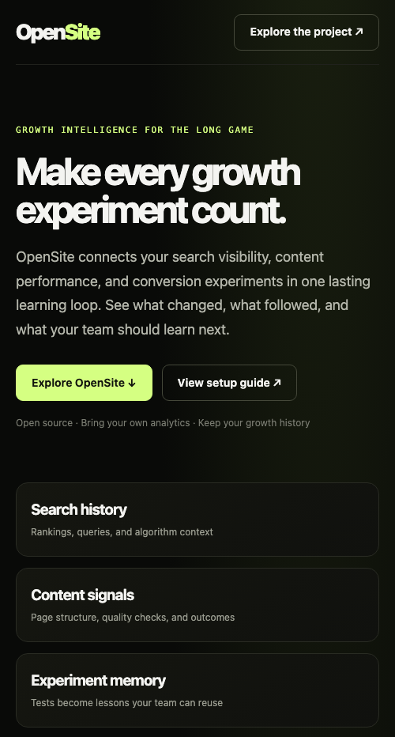
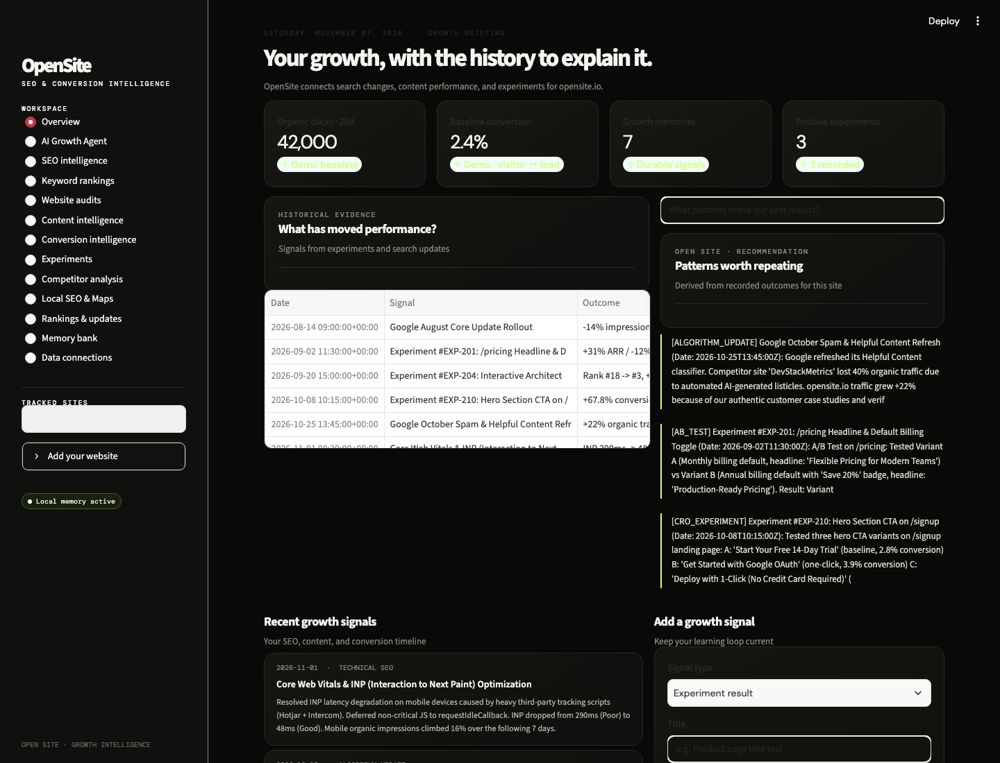

<p align="center">
  
</p>

<h1 align="center">OpenSite</h1>
<p align="center"><strong>SEO & Conversion Intelligence Agent</strong><br />Understand. Optimize. Grow.</p>

OpenSite is a growth intelligence workspace for marketing teams. It brings search visibility, website health, analytics, content performance, and experiment outcomes into one history, then uses that evidence to help decide what to improve next.

## Screenshots

The landing-page captures show the static site. The dashboard capture is from the working local Streamlit app; it shows demo history until you connect a verified property and data source.






## What OpenSite does

- **Growth overview:** review saved site signals and ask the advisor questions grounded in that history.
- **AI Growth Agent:** retrieve site evidence, ask a question, save an evidence-linked recommendation, and record the measured result after implementation. Optional Ollama provides local synthesis; without a model, the agent returns matching evidence.
- **SEO intelligence:** review connected Search Console trends, the latest ranking snapshot, and issues from the most recent technical crawl.
- **Website auditor:** crawl a public site, respect `robots.txt`, and flag missing or duplicate metadata, heading issues, and images without alt text. Audit results become memories.
- **Content intelligence:** inspect crawled word counts, H1/H2 structure, text samples, and metadata at page level.
- **Competitor intelligence:** compare a limited crawl of public competitor pages. It does not invent competitor traffic, rank, or backlink data.
- **Keyword rankings:** import query metrics from Google Search Console or position history from SerpBear.
- **Analytics connections:** read metrics from GA4, Plausible, PostHog, Umami, and Matomo.
- **Conversion intelligence:** chart GA4 session/conversion history and record comparable visitor-to-lead snapshots.
- **Experiments:** record hypotheses and outcomes; import experiment records from GrowthBook.
- **Two-variant comparison:** save control/variant visitors and conversions, compare conversion rates, and show a two-proportion p-value only when expected counts support the normal approximation. Repeated peeking, randomization quality, and multiple tests still need human review.
- **Local SEO & Maps:** save a business location and public profile details, geocode it on request, and plot saved locations.
- **Search updates and page changes:** import official Google Search Central announcements into a site's timeline and log page, ranking, and technical changes against the outcome history. Timing indicates context, not cause.
- **Performance:** run PageSpeed Insights and import Chrome UX Report field metrics.
- **Historical memory:** search saved audits, analytics snapshots, ranking history, and team-entered experiments.

## Quick start

Python 3.12 is used by the deployment container. From the repository root:

```bash
python3 -m venv .venv
source .venv/bin/activate
pip install -r requirements.txt
streamlit run app/main.py
```

In the app, choose **Add your website** in the sidebar, then open **Data connections** to authorize providers. Demo properties and history are examples; add your own site before using any data for reporting.

## How memory works

OpenSite gives each property its own memory bank. A successful data import, crawl, or manually recorded experiment is stored with its date, source tags, and metadata. Search and the growth advisor retrieve relevant memories before responding. Recommendations should distinguish observed changes from hypotheses; a ranking change near an algorithm update is correlation, not proof of causation.

The default local backend stores memory in `app/data/memories.json`, so it survives local app restarts. For a deployed service, use Firestore by setting `OPENSITE_MEMORY_BACKEND=firestore`; the Cloud Run service account needs Firestore access. The Firestore collection defaults to `opensite_memories`. Hindsight can also be enabled as an optional remote memory service by installing `hindsight-client` and setting `HINDSIGHT_BASE_URL` and `HINDSIGHT_API_KEY`. OpenSite keeps local/Firestore memory as its data source and mirrors writes to Hindsight when configured.

For generated natural-language synthesis, run Ollama locally, pull a model such as `qwen2.5:7b`, and set `OLLAMA_ENABLED=true`, `OLLAMA_BASE_URL`, and `OLLAMA_MODEL`. Without Ollama, the advisor presents relevant stored evidence without claiming to run an LLM.

## Connectors and credentials

All analytics connectors are read-only. OpenSite does not receive private account data until the site owner supplies credentials and grants property access.

| Source | OpenSite uses | Access needed |
| --- | --- | --- |
| Google Search Console | Clicks, impressions, CTR, position, query rows, and per-page query performance | OAuth token with `webmasters.readonly` and verified property access |
| Google Analytics 4 | Sessions, users, conversion events | OAuth token with `analytics.readonly` and GA4 property access |
| SerpBear | Tracked keywords and saved position history | SerpBear URL and API key |
| Plausible, PostHog, Umami, Matomo | Analytics summaries and events | Provider API key/token and site/project ID |
| GrowthBook | Existing experiment records | Read-only GrowthBook API key |
| PageSpeed Insights | Lighthouse performance, SEO, and accessibility audits | Normally no key for personal use; quotas apply |
| Chrome UX Report | Aggregated real-user Core Web Vitals | Google Cloud API key with CrUX API enabled |
| Google Search Central | Official search announcements | Public RSS feed |

Credentials entered in the Streamlit UI remain in that browser session and are not written to the memory bank. Google OAuth access tokens expire and must be refreshed. External SERP positions, search-volume estimates, and backlink indexes need a separately configured data provider; open-source software alone cannot supply those datasets.

Local SEO geocoding uses the configurable `OPENSITE_NOMINATIM_URL`. If using the public Nominatim service, every lookup is user-triggered and cached in-process; obey the [Nominatim usage policy](https://operations.osmfoundation.org/policies/nominatim/) (including its maximum of one request per second), provide suitable attribution, and switch to a provider you operate or are authorized to use if your usage grows. OpenStreetMap data is © OpenStreetMap contributors and available under ODbL.

## Run with `.env`

Copy `.env.example` to `.env` for local options. Do not commit `.env` or provider keys.

```bash
cp .env.example .env
```

`OPENSITE_ACCESS_PASSWORD` enables an optional shared-password gate for a public deployment. It is unset locally by default. For deployed secrets, prefer Google Secret Manager over checked-in files or plain-text shell history.

## Firebase deployment

The Firebase project is `opensite-growth-mr444`; its Hosting site alias `opensite` maps to `opensite-growth-mr444-hosting`. The responsive project page from `docs/` is live at [opensite-growth-mr444-hosting.web.app](https://opensite-growth-mr444-hosting.web.app). The interactive Streamlit app requires Cloud Run.

The project and Hosting site have been created. Cloud Run requires an active billing account even when staying within its free quota. The following steps apply only after linking an open billing account to the Firebase project and enabling Cloud Run, Cloud Build, Artifact Registry, Secret Manager, and Firestore APIs:

1. Create a Secret Manager secret named `opensite-access-password` containing a strong password, then grant the Cloud Run service account access to that secret.
2. Create the default Firestore database in Native mode. Choose a location near the Cloud Run service and users; the location cannot be changed after creation. Grant the Cloud Run service account Firestore access and set `OPENSITE_MEMORY_BACKEND=firestore`.
3. Deploy the app from the repository root:

```bash
gcloud config set project opensite-growth-mr444
gcloud run deploy opensite --source . --project opensite-growth-mr444 --region us-central1 --allow-unauthenticated --port 8080 --min 0 --max 2 --memory 1Gi --set-env-vars OPENSITE_MEMORY_BACKEND=firestore --set-secrets OPENSITE_ACCESS_PASSWORD=opensite-access-password:latest
```

Cloud Run prints the interactive app's service URL when deployment completes. Firebase Hosting remains the static project page; deploy it separately when `docs/` changes.

Cloud Run requires an open billing account even though it has a free usage quota. The only billing account available during setup is closed. Google also rejected enabling Cloud Run, Cloud Build, Artifact Registry, and Secret Manager APIs without an open billing account, so the Python app is not deployed yet. Usage beyond included quotas can be billed. Firebase Hosting currently serves the static landing page; it cannot run this Python app by itself.

## Deploy the interactive app without Firebase billing

The repository is ready for [Streamlit Community Cloud](https://share.streamlit.io/), an open-source-friendly hosting option for Streamlit apps. Sign in with GitHub, create an app, and select:

- Repository: `mallikarjunr444-gif/OpenSite`
- Branch: `main`
- Main file: `app/main.py`
- Python: `3.12`

This one-time deploy must be completed from your Streamlit account. Add API credentials only in Streamlit's Secrets settings. Do not add OAuth tokens, analytics keys, or passwords to GitHub. Community Cloud is suitable for getting the interactive UI online; configure a durable memory provider before relying on it for long-term production history.

## GitHub Pages project site

The responsive project page is live on [GitHub Pages](https://mallikarjunr444-gif.github.io/OpenSite/) and [Firebase Hosting](https://opensite-growth-mr444-hosting.web.app). GitHub Actions publishes it from `main`; Firebase deployments use `firebase deploy --only hosting:opensite --project opensite-growth-mr444`. The static page links to the Streamlit app deployment and displays a dashboard preview; the interactive app runs separately on Streamlit Community Cloud or another server host.

## Current scope

Implemented now: Streamlit workspace; local and Firestore memory backends; optional Hindsight mirroring; user-added sites; technical crawler and crawl-based content analysis; public competitor page comparison; Search Console/SerpBear rankings; read-only analytics and GrowthBook imports; PageSpeed/CrUX; official search update feed; AI recommendation and measured-outcome capture; conversion snapshots; user-entered business locations with geocoding and maps; optional Ollama synthesis; and static GitHub Pages/Firebase landing pages.

Still requiring additional implementation or provider configuration: user accounts and team permissions, a full PostgreSQL/pgvector migration, scheduled sync and alerts, local rank tracking beyond geocoded business locations, automated competitor SERP/backlink research, and direct GrowthBook experiment creation/management. SERP and competitor datasets may require a separately configured provider. Review third-party licenses before redistributing integrated services.

## Project layout

```text
app/                 Streamlit UI, connectors, crawler, and memory
assets/              OpenSite brand assets
docs/                Static GitHub Pages project site
.github/workflows/   Pages publishing workflow
Dockerfile           Cloud Run container
firebase.json        Firebase Hosting static project page configuration
.firebaserc          OpenSite Firebase project and Hosting target
.env.example         Local configuration template
```
